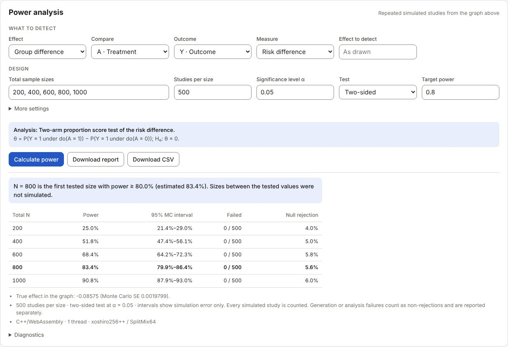

# DAG simulator and power-analysis design

The **Calculator** tab retains its existing formulas, guide and forms. Its C++ /
WebAssembly engine also powers the **DAG simulator** tab, which opens `web/dag.html` and
constructs a data generating process from generic variables. There are no
prescribed covariate, treatment, mediator or outcome roles. A label has no
special effect on the model. A treatment or outcome role is not required to
generate data. The **Power analysis** panel names the comparison to detect by
selecting generic variables for it.

## Workflow

1. Start with an empty canvas and click **Add variable**, or load an example.
2. Select the variable and edit its identifier, label, type, distribution and
   parameters. Apply the settings. Renaming updates arrows, interactions and
   censoring references.
3. Connect variables with a variable's plus port on the canvas, or with
   **Add** under *New arrow into …* in the selected variable's settings, which
   offers only parents that keep the graph acyclic. An arrow adds a parent term
   to the child's conditional predictor. Select the child to edit coefficients
   or add interactions between two parents. **Tidy layout** arranges the graph
   left to right in generation order.
4. Read the graph and the conditional equations below it. A box shows its
   variable's values if it has no parents (for example `Normal · mean 0, SD 1`),
   otherwise the scale its incoming coefficients act on (`Bernoulli · log-odds`,
   `Weibull · log HR`), and sketches the variable from 2,000 draws of the
   current model (seed 1), redrawn a moment after each change: a histogram,
   the share of 1s for a binary variable, or the survival curve of an event
   time. Click the number on an arrow (or press Enter on a focused arrow) to
   change its coefficient in place. Right-click a box, press C or O on it, or
   use the *Compared* / *Outcome* buttons in its settings to make it the power
   analysis's compared variable or outcome; the two swap if needed. The
   power analysis's variables are tagged on the graph, and the arrows that
   carry the tested effect are highlighted.
   **Paths from A to Y**, under the graph, lists every path between the
   compared variable and the outcome (up to 40) as causal, back-door or other
   non-causal, and whether the planned analysis leaves it open or blocks it (at
   a collider, or by adjusting for a variable); hovering a path marks its
   arrows. An open non-causal path is flagged because it would mix
   confounding into the estimate. **Simulated dataset**, folded away at the
   bottom, generates one seeded dataset, summarizes every column and downloads
   it as CSV.
5. In **Power analysis**, choose what to detect (a group difference or a
   regression coefficient, the variable compared, the outcome, the measure, a
   time horizon for survival measures and an optional effect to detect) and the
   design (total sample sizes, studies per size, alpha, the test's sides and
   target power), then **Calculate power**. The panel starts from a runnable
   choice and shows the analysis it will fit, or why it cannot run, as you edit.
   Null value, comparison levels, seed, calibration and the null-scenario check
   are under **More settings**. Inspect uncertainty and failed fits.
6. Export/import the design as JSON. The graph, estimand and power settings are saved in browser storage
   when available. Undo/redo supports 50 edits. A deleted or replaced model
   can be recovered with Undo.

Drag nodes or move them with keyboard arrow keys. All model editing is also
available through the variable settings. The canvas scrolls on small screens.

## Distributions

For each variable the predictor is `eta = intercept + sum(beta * parent)` plus
any explicitly specified pairwise products. Coefficients use the parents'
original units. All generated variables can be parents, subject to acyclicity.

| Type | Distribution | Conditional parameters |
| --- | --- | --- |
| Continuous | Normal | Mean `eta`, positive residual SD |
| Continuous | Uniform | Center `eta`, positive width; endpoints `eta ± width/2` |
| Continuous | Log-normal | Mean of log values `eta`, positive SD of log values |
| Continuous | Gamma | Mean `exp(eta)`, positive shape; scale `exp(eta)/shape` |
| Binary | Bernoulli | Success probability `logistic(eta)` |
| Count | Poisson | Mean `exp(eta)` |
| Survival time | Weibull | Positive shape `k` and baseline scale `s`, with `S(t | parents) = exp(-(t/s)^k * exp(eta))` |
| Survival time | Exponential | Weibull with shape fixed at 1 |

Survival parent coefficients are log hazard ratios in this version. A positive
coefficient shortens event times. The survival inverse transform is evaluated
on the log time scale. Log-normal is a positive continuous variable; it can
also supply censoring times. Other survival parameterizations and categorical
distributions can be added to the distribution registry in later work.

Exogenous draws are independent across variables and rows. Dependencies arise
through parent terms and shared ancestors. Roots are independent unless an
explicit ancestor is introduced. Variable labels do not enforce randomization
or determine an adjustment set. Interactions apply on the child's predictor
scale; main coefficients then apply when interacting parents equal zero.

## Survival observations

A survival variable `T` always generates its latent event time. Its optional
observation rule uses no censoring, a positive administrative cutoff, or a
different generated variable `C` as the censoring time. The simulator then adds:

- `T_time = min(T, C)`
- `T_event = 1{T <= C}`

Without censoring, `T_time` equals `T` and all event indicators equal one.
Censoring variables must generate nonnegative values; invalid realizations
stop the run rather than being clipped. Every survival variable gets its own
observed time and indicator columns, including an uncensored survival variable
used as `C`. A derived column cannot conflict with another variable ID.

The censoring observation rule is separate from hazard dependencies: choosing
`C` as a censoring variable does not add an arrow into `T`'s hazard model.
The graph can separately specify shared ancestors or an arrow between `T` and
`C`. Consequently, independent censoring is a modeling choice, not a guarantee
of this flexible interface. Observation columns are outputs and cannot be
parents in the same simulation. Removing `C` resets affected observation rules
to uncensored; Undo restores them.

## Executable model contract

`dag-model.js` provides editor validation, graph transformations and displayed
equations. All data generation, population-effect evaluation, calibration, model
fitting, hypothesis tests and power aggregation execute in `core/src/dag/`,
compiled into the calculator’s existing `ssc_web` and `ssc_web_mt` engines. A JSON graph contains `version: 1`, `nodes` and `edges`. Each node has:

- `id`, `label`, `kind`, `family`, `intercept`, `interactions`, `x`, `y`
- Distribution parameters such as `sd`, `width`, `shape` and `scale`
- For survival: `censoring: {mode, time, variable}`

Arrows have `{source, target, coefficient}`. Interactions on a child have
`{left, right, coefficient}`, using two different existing parents. Deleting a
parent arrow also deletes interactions that depend on it. Renaming a variable
updates all references. Unknown imported fields are discarded, never executed.
IDs contain at most 32 letters/digits/underscores, start with a letter and are
unique. Labels can have up to 80 characters. Empty graphs can be edited and
saved but require at least one variable before data generation.

The graph supports 40 variables and 1–50,000 observations, with uint32 seeds.
Poisson means must be representable and in `(0, 1000]`; extreme parameters that
produce overflow or underflow stop with an error rather than clipping. Sampling uses the calculator’s xoshiro256++ generator with SplitMix64 streams,
Marsaglia polar Normal draws, Marsaglia–Tsang Gamma draws, inverse transforms
and exact Poisson additivity. Streams are indexed by seed, replicate, scenario,
variable ID and subject. Paired interventions reuse the same exogenous draws;
mediators respond through their structural equations. A larger study contains
the same first subjects, and reordering or repositioning nodes does not change
draws. Changing a variable ID selects a different stream. Fixed seeds from the
former JavaScript prototype will generate different datasets with this engine.

The `ssc_dag_json(request, token)` C API returns `{ok, result}` or `{ok: false,
error}`. Operations are `simulate`, `plan`, `population`, `calibrate`, `analyze`,
`nullGraph` and `power`. Each request contains `graph`; target-related operations
also contain `estimand`. `power` accepts `settings` and optional `threads`
(0 selects the available cores); `simulate` accepts `options: {n, seed}`.
Every request is independently validated in C++. The browser’s method hint
cannot override the estimator selected by the engine.

The same `Engine` and `worker.js` used by the calculator load WebAssembly in a
background worker. A cross-origin isolated page uses the pthread build; other
pages or failed threaded starts use the single-thread build. Replicates use the
calculator’s C++ thread pool and are reduced in replicate order, so changing
thread count does not change results. A memory budget limits concurrent fit
workspaces. Progress is posted between native batches; Stop terminates the
worker. There is no JavaScript simulation or numerical-analysis fallback.

The exported design envelope is `{version: 1, graph, estimand, power}`. The graph uses
the contract above; `estimand` holds the power panel's target (null while the
graph has fewer than two variables). `estimand-model.js` validates the target
independently of data generation. Standalone graph files can still be imported.
Renaming a variable updates the target's references; a graph change that makes
the target invalid replaces it with the panel's default and says so. Undo
restores both the graph and the target. Target choices never add/remove arrows
in the drawn graph. The target selects a compatible executable analysis, shown
before calculation.

Data generation runs in a cancellable module worker. Structural edits and
simulation input changes invalidate results and stop pending work. JSON export
contains the structural model; sample size and seed are run inputs shown with
the result. CSV includes every variable and derived survival observation column.

## The power target (estimand)

The target is distinct from the estimator or analysis used for power. The panel
supports two target types:

- **Group difference** (a marginal total-effect contrast): intervention levels for a selected
  variable, with a difference in means, binary risk difference/ratio or marginal
  odds ratio, survival probability difference at a time, or RMST difference.
  Marginal targets integrate over the population specified by the DGP. Mediators
  follow their generating models under each intervention; they are not held
  fixed or automatically included as adjustment variables.
- **Regression coefficient** (a conditional model coefficient): an existing predictor-to-outcome arrow,
  on the child's predictor scale or an exponentiated scale when meaningful.
  With interactions, the main coefficient applies at zero values of the
  interacting parents. It is not presented as a marginal total effect.

The population is the graph's distribution; the exported target records it as
text, which does not subset or reweight simulated data. A custom text target,
which has no executable analysis, can still be read by `estimand-model.js`; the
panel replaces it with its default. For a binary outcome the panel offers the
risk difference and not the identical mean difference. Survival probability and
RMST targets require a positive horizon (by default the administrative cutoff
or the baseline time scale) and refer to latent event time, independent of the
observation/censoring mechanism. The panel shows the target's formula and null
value under the analysis it selects. Ratio nulls default to one; difference
and coefficient nulls default to zero. A numerical planning alternative calibrates an eligible arrow in a copy of the
DGP before power simulation. Changing the effect measure clears an alternative
entered on the old scale. Leaving it blank uses the graph as drawn.

The target is kept with the design, included in JSON export and undo/redo,
and restored on reopening the design. Changing it does not invalidate generated
raw data, because the DGP itself is unchanged.

## Analysis and power evaluation

The target selects the estimator, test scale, null and survival horizon.
The design adds total sample sizes, repetitions, alpha, a two-sided or
one-sided rejection rule, a seed and target power. Changing the saved target,
graph or settings clears previous results; an invalid target cannot run, and the panel says why.

| Saved target | Analysis fitted to each simulated study |
| --- | --- |
| Marginal mean difference (continuous/count) | Welch t test |
| Binary mean/risk difference | Two-proportion score test at null 0; Wald at a shifted null |
| Marginal risk or odds ratio | Wald test on the log ratio scale |
| Survival probability difference at the horizon | Kaplan–Meier estimate and Greenwood Wald test |
| RMST difference through the horizon | Kaplan–Meier area and its Greenwood covariance variance, Wald test |
| Conditional Normal/Uniform coefficient | Linear regression coefficient t test (approximate for Uniform errors) |
| Conditional Log-normal coefficient | Log-response linear regression t test |
| Conditional Bernoulli/Poisson/Gamma coefficient | Logistic or log-link GLM Wald test; Gamma dispersion estimated from the sample |
| Conditional survival coefficient / hazard ratio | Cox PH Wald test with Breslow ties; ratio targets tested on the log scale |

Marginal arm comparisons currently require a nondegenerate binary root variable,
representing independent randomization. Confounded or continuous interventions
can be described and simulated, but need another estimator before power can
run. Conditional analyses fit all outcome parents and specified interactions,
retaining the selected structural coefficient. Rank deficiency, separation and
nonconvergence are explicit failures. No true DGP variance or coefficient is
substituted for an estimated standard error.

Survival fits use observed time and event status, never latent outcome values.
Unadjusted KM power refuses event/censoring shared ancestors beyond the arm,
and horizons beyond administrative follow-up. Within a replicate, a positive
KM curve is not extended beyond the last observed follow-up; insufficient
follow-up is reported as an analysis failure. Cox power rejects censoring that
depends on the event time and regressions using censored latent predictors.
Normal/Wald approximations still require adequate sample sizes and events.
Custom text targets require an executable estimator/test and cannot run power.

### Alternative and null DGPs

Marginal effects are evaluated by paired `do(A=active)` and `do(A=reference)`
population simulations. Calibration adjusts a selected arrow on a directed path
to the outcome using bracketed search. Mediated paths are included: for the
mediation example, the total mean difference is `0.3 + 0.8 * 0.6 = 0.78`.
Targeting 0.5 therefore adjusts the direct arrow toward 0.02, not 0.5. A separate
random stream verifies the resulting effect and reports population Monte Carlo
uncertainty. Unreachable targets or failed calibration stop the run. Conditional
coefficient calibration is exact (log transform for an exponentiated target).
The graph stays as drawn; the report includes the actual alternative graph.

For the usual marginal no-effect null, every exposure effect on causal paths
to the outcome, including interactions involving the exposure, is zeroed.
Other paths and observation rules remain. This handles mediated effects rather
than zeroing only the direct arrow. Conditional nulls set the selected
coefficient. Shifted marginal nulls are Monte Carlo calibrated and labeled
approximate reference scenarios, with their effect uncertainty exposed.

### Results and reproduction

Power is rejections divided by **all** simulated studies. Failed generation or
analysis remains in the denominator as non-rejection, with failure reasons and
counts shown. Results include pointwise 95% Wilson Monte Carlo intervals,
Monte Carlo SEs, mean estimates, empirical SDs, mean test-scale SEs and optional
null rejection rates. The reported sample size is the first **tested** N whose
point estimate reaches target power; intermediate sizes are not inferred.

Download the complete JSON report or the power table as CSV. The JSON is a
superset of the design envelope, with the original graph, saved estimand,
settings, calibrated graphs, verified effects, analysis and engine metadata,
results and diagnostics. It can be reimported as a design. Reproduction uses
the same engine version, seed and settings; floating-point library differences
may produce small differences between native and WebAssembly builds.
Clustering, longitudinal processes and additional estimators require explicit
extensions; none are inferred from variable labels.

Method references: [R survival Cox documentation](https://stat.ethz.ch/R-manual/R-devel/library/survival/html/coxph.html),
[R survival methods](https://cran.r-project.org/web/packages/survival/vignettes/methods.pdf),
[Emscripten pthreads](https://emscripten.org/docs/porting/pthreads.html).

## Validation

`npm test --prefix web` checks analytic Normal mediation moments and effects,
Bernoulli probabilities, Poisson moments, Uniform/Log-normal/Gamma distributions,
Weibull/exponential conditional survival probabilities, both censoring rules,
interactions, arbitrary variable-only DAGs, graph validity, renaming, seeded
reproducibility, JSON/CSV interchange and input rejection. Estimand checks cover
total versus conditional targets, ratio/difference nulls, survival horizons,
comparison levels, custom targets, renaming and saved-design round trips.

The site tests exercise the separate page, cycle checks, editing, simulation,
CSV/JSON downloads, survival and censoring, offline use and return to the
calculator. Both pages and their assets are versioned and cached; each page
retains its own Content Security Policy. The DAG page uses the same C++/WebAssembly engine loader, thread fallback and
offline cache as the calculator. Its policy permits WebAssembly compilation.

The C++ tests check independent NumPy/SciPy fits for seven model families,
KM/RMST variance, invalid and singular analyses, native cancellation and
identical one-thread/four-thread power results. The web tests call the real
WebAssembly engine for distribution checks, calibration, null construction,
survival observation handling, power curves and saved-report reproduction.

## Preview

