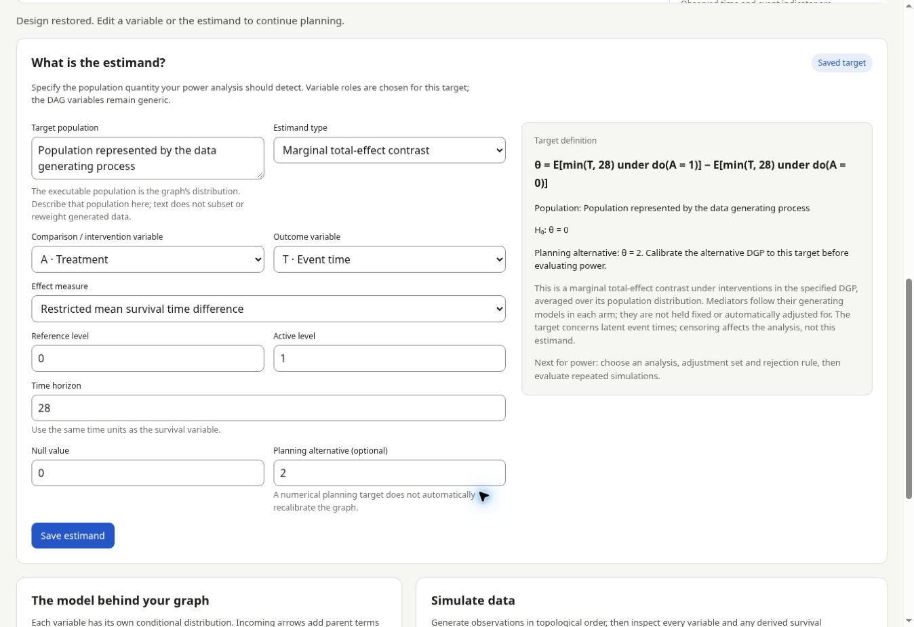

# DAG simulator and power-analysis design

The **Calculator** tab retains the existing formulas, guide, forms and C++ /
WebAssembly engine. The new **DAG simulator** tab opens `web/dag.html` and
constructs a data generating process from generic variables. There are no
prescribed covariate, treatment, mediator or outcome roles. A label has no
special effect on the model. A treatment or outcome role is not required to
generate data. Power-analysis targets are specified in the separate estimand
section by selecting generic variables for the intended comparison.

## Workflow

1. Start with an empty canvas and click **Add variable**, or load an example.
2. Select the variable and edit its identifier, label, type, distribution and
   parameters. Apply the settings. Renaming updates arrows, interactions and
   censoring references.
3. Connect variables using their plus ports or the From / To form. An arrow
   adds a parent term to the child's conditional predictor. Select the child
   to edit coefficients or add interactions between two parents.
4. Inspect the displayed conditional equations. Generate a seeded dataset,
   inspect all variable summaries and the first 10 rows, and download CSV.
5. Define and save the estimand: its population, comparison, outcome, effect
   measure, time horizon where relevant, null value and optional planning alternative.
6. Export/import the design as JSON. The graph and estimand are also saved in browser storage
   when available. Undo/redo supports 50 edits. A deleted or replaced model
   can be recovered with Undo.

Drag nodes or move them with keyboard arrow keys. All model editing is also
available through the inspector and forms. The canvas scrolls on small screens.

## Distributions

For each variable the predictor is `eta = intercept + sum(beta * parent)` plus
any explicitly specified pairwise products. Coefficients use the parents'
original units. All generated variables can be parents, subject to acyclicity.

| Type | Distribution | Conditional parameters |
| --- | --- | --- |
| Continuous | Normal | Mean `eta`, positive residual SD |
| Continuous | Uniform | Center `eta`, positive width; endpoints `eta ± width/2` |
| Continuous | Log-normal | Mean of log values `eta`, positive SD of log values |
| Continuous | Gamma | Mean `exp(eta)`, positive shape; scale `exp(eta)/shape` |
| Binary | Bernoulli | Success probability `logistic(eta)` |
| Count | Poisson | Mean `exp(eta)` |
| Survival time | Weibull | Positive shape `k` and baseline scale `s`, with `S(t | parents) = exp(-(t/s)^k * exp(eta))` |
| Survival time | Exponential | Weibull with shape fixed at 1 |

Survival parent coefficients are log hazard ratios in this version. A positive
coefficient shortens event times. The survival inverse transform is evaluated
on the log time scale. Log-normal is a positive continuous variable; it can
also supply censoring times. Other survival parameterizations and categorical
distributions can be added to the distribution registry in later work.

Exogenous draws are independent across variables and rows. Dependencies arise
through parent terms and shared ancestors. Roots are independent unless an
explicit ancestor is introduced. Variable labels do not enforce randomization
or determine an adjustment set. Interactions apply on the child's predictor
scale; main coefficients then apply when interacting parents equal zero.

## Survival observations

A survival variable `T` always generates its latent event time. Its optional
observation rule uses no censoring, a positive administrative cutoff, or a
different generated variable `C` as the censoring time. The simulator then adds:

- `T_time = min(T, C)`
- `T_event = 1{T <= C}`

Without censoring, `T_time` equals `T` and all event indicators equal one.
Censoring variables must generate nonnegative values; invalid realizations
stop the run rather than being clipped. Every survival variable gets its own
observed time and indicator columns, including an uncensored survival variable
used as `C`. A derived column cannot conflict with another variable ID.

The censoring observation rule is separate from hazard dependencies: choosing
`C` as a censoring variable does not add an arrow into `T`'s hazard model.
The graph can separately specify shared ancestors or an arrow between `T` and
`C`. Consequently, independent censoring is a modeling choice, not a guarantee
of this flexible interface. Observation columns are outputs and cannot be
parents in the same simulation. Removing `C` resets affected observation rules
to uncensored; Undo restores them.

## Executable model contract

`dag-model.js` is independent of the DOM, worker and calculator engine.
`validateGraph`, `parseGraph` and `simulateGraph` provide the reusable model
contract. A JSON graph contains `version: 1`, `nodes` and `edges`. Each node has:

- `id`, `label`, `kind`, `family`, `intercept`, `interactions`, `x`, `y`
- Distribution parameters such as `sd`, `width`, `shape` and `scale`
- For survival: `censoring: {mode, time, variable}`

Arrows have `{source, target, coefficient}`. Interactions on a child have
`{left, right, coefficient}`, using two different existing parents. Deleting a
parent arrow also deletes interactions that depend on it. Renaming a variable
updates all references. Unknown imported fields are discarded, never executed.
IDs contain at most 32 letters/digits/underscores, start with a letter and are
unique. Labels can have up to 80 characters. Empty graphs can be edited and
saved but require at least one variable before data generation.

The graph supports 40 variables and 1–50,000 observations, with uint32 seeds.
Poisson means must be representable and in `(0, 1000]`; extreme parameters that
produce overflow or underflow stop with an error rather than clipping. Sampling
uses seeded Mulberry32, Box–Muller Normal draws, inverse transforms for
Uniform/Log-normal/survival, Marsaglia–Tsang Gamma draws and exact Poisson draws
using rate chunks. Identical graph order, sample size and seed reproduce a
dataset. No common random number guarantee is made when sample size or node
order changes. Moving canvas positions does not change simulated values.

The exported design envelope is `{version: 1, graph, estimand}`. The graph uses
the contract above; `estimand` is null until saved. `estimand-model.js` validates
the target independently of data generation. Standalone graph files can still
be imported. Renaming a variable updates estimand references; an incompatible
graph change clears the saved target with an explanation. Undo restores both
the graph and estimand. Estimand choices never add/remove arrows or choose an
analysis adjustment set.

Data generation runs in a cancellable module worker. Structural edits and
simulation input changes invalidate results and stop pending work. JSON export
contains the structural model; sample size and seed are run inputs shown with
the result. CSV includes every variable and derived survival observation column.

## What is the estimand?

The target is distinct from the estimator or analysis used for power. The UI
supports three target types:

- **Marginal total-effect contrast:** intervention levels for a selected
  variable, with a difference in means, binary risk difference/ratio or marginal
  odds ratio, survival probability difference at a time, or RMST difference.
  Marginal targets integrate over the population specified by the DGP. Mediators
  follow their generating models under each intervention; they are not held
  fixed or automatically included as adjustment variables.
- **Conditional model coefficient:** an existing predictor-to-outcome arrow,
  on the child's predictor scale or an exponentiated scale when meaningful.
  With interactions, the main coefficient applies at zero values of the
  interacting parents. It is not presented as a marginal total effect.
- **Custom definition:** a user-written population quantity, recorded for an
  explicit estimator and simulation evaluation to be supplied separately.

The population description documents the graph's target population; it does
not subset or reweight simulated data. Survival probability and RMST targets
require a positive horizon and refer to latent event time, independent of the
observation/censoring mechanism. The target preview shows its formula, the null
value, and any planning alternative. Ratio nulls default to one; difference
and coefficient nulls default to zero. A numerical alternative is a planning
target, not an automatic recalibration of the DGP. Its consistency with the
alternative generating model must be established before computing power.

The estimand is saved separately, included in JSON export and undo/redo, and
restored on reopening the design. Changing it does not invalidate generated
raw data, because the DGP itself is unchanged.

## Analysis and power evaluation

Keep the data generating graph separate from the study design, estimand and
analysis specification. Future repeated simulations will fit the selected
analysis to each dataset and record rejection probabilities, Monte Carlo
uncertainty and fitting failures. The graph alone does not select a test or
identify the desired treatment contrast. A null for a total effect cannot in
general be formed by zeroing only a direct arrow while mediated paths remain.
Clustering, longitudinal processes and further distributions need explicit
extensions; none are inferred from a variable's name.

## Validation

`npm test --prefix web` checks analytic Normal mediation moments and effects,
Bernoulli probabilities, Poisson moments, Uniform/Log-normal/Gamma distributions,
Weibull/exponential conditional survival probabilities, both censoring rules,
interactions, arbitrary variable-only DAGs, graph validity, renaming, seeded
reproducibility, JSON/CSV interchange and input rejection. Estimand checks cover
total versus conditional targets, ratio/difference nulls, survival horizons,
comparison levels, custom targets, renaming and saved-design round trips.

The site tests exercise the separate page, cycle checks, editing, simulation,
CSV/JSON downloads, survival and censoring, offline use and return to the
calculator. Both pages and their assets are versioned and cached; each page
retains its own Content Security Policy. The DAG page loads no calculator
engine or WebAssembly.

## Preview

