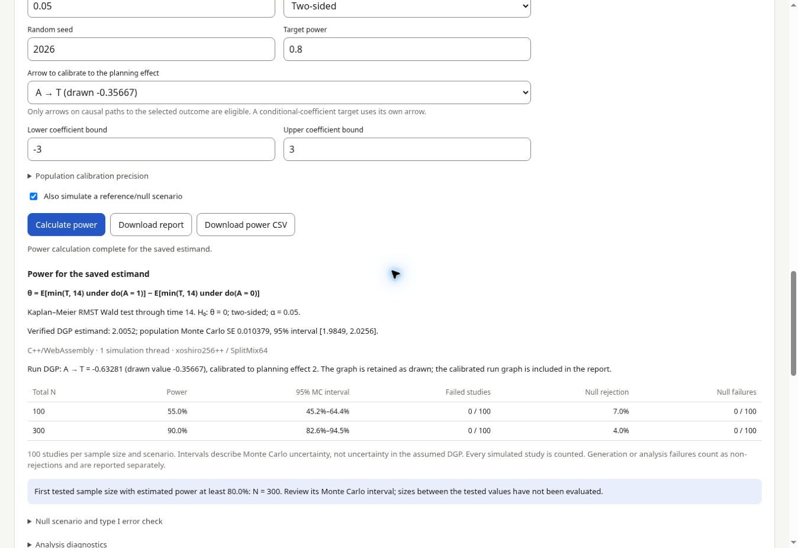

# DAG simulator and power-analysis design

The **Calculator** tab retains its existing formulas, guide and forms. Its C++ /
WebAssembly engine also powers the **DAG simulator** tab, which opens `web/dag.html` and
constructs a data generating process from generic variables. There are no
prescribed covariate, treatment, mediator or outcome roles. A label has no
special effect on the model. A treatment or outcome role is not required to
generate data. Power-analysis targets are specified in the separate estimand
section by selecting generic variables for the intended comparison.

## Workflow

1. Start with an empty canvas and click **Add variable**, or load an example.
2. Select the variable and edit its identifier, label, type, distribution and
   parameters. Apply the settings. Renaming updates arrows, interactions and
   censoring references.
3. Connect variables using their plus ports or the From / To form. An arrow
   adds a parent term to the child's conditional predictor. Select the child
   to edit coefficients or add interactions between two parents.
4. Inspect the displayed conditional equations. Generate a seeded dataset,
   inspect all variable summaries and the first 10 rows, and download CSV.
5. Define and save the estimand: its population, comparison, outcome, effect
   measure, time horizon where relevant, null value and optional planning alternative.
6. Set total sample sizes, repetitions, significance level and rejection direction,
   then calculate power for the saved estimand. Inspect uncertainty and failed fits.
7. Export/import the design as JSON. The graph, estimand and power settings are saved in browser storage
   when available. Undo/redo supports 50 edits. A deleted or replaced model
   can be recovered with Undo.

Drag nodes or move them with keyboard arrow keys. All model editing is also
available through the inspector and forms. The canvas scrolls on small screens.

## Distributions

For each variable the predictor is `eta = intercept + sum(beta * parent)` plus
any explicitly specified pairwise products. Coefficients use the parents'
original units. All generated variables can be parents, subject to acyclicity.

| Type | Distribution | Conditional parameters |
| --- | --- | --- |
| Continuous | Normal | Mean `eta`, positive residual SD |
| Continuous | Uniform | Center `eta`, positive width; endpoints `eta ± width/2` |
| Continuous | Log-normal | Mean of log values `eta`, positive SD of log values |
| Continuous | Gamma | Mean `exp(eta)`, positive shape; scale `exp(eta)/shape` |
| Binary | Bernoulli | Success probability `logistic(eta)` |
| Count | Poisson | Mean `exp(eta)` |
| Survival time | Weibull | Positive shape `k` and baseline scale `s`, with `S(t | parents) = exp(-(t/s)^k * exp(eta))` |
| Survival time | Exponential | Weibull with shape fixed at 1 |

Survival parent coefficients are log hazard ratios in this version. A positive
coefficient shortens event times. The survival inverse transform is evaluated
on the log time scale. Log-normal is a positive continuous variable; it can
also supply censoring times. Other survival parameterizations and categorical
distributions can be added to the distribution registry in later work.

Exogenous draws are independent across variables and rows. Dependencies arise
through parent terms and shared ancestors. Roots are independent unless an
explicit ancestor is introduced. Variable labels do not enforce randomization
or determine an adjustment set. Interactions apply on the child's predictor
scale; main coefficients then apply when interacting parents equal zero.

## Survival observations

A survival variable `T` always generates its latent event time. Its optional
observation rule uses no censoring, a positive administrative cutoff, or a
different generated variable `C` as the censoring time. The simulator then adds:

- `T_time = min(T, C)`
- `T_event = 1{T <= C}`

Without censoring, `T_time` equals `T` and all event indicators equal one.
Censoring variables must generate nonnegative values; invalid realizations
stop the run rather than being clipped. Every survival variable gets its own
observed time and indicator columns, including an uncensored survival variable
used as `C`. A derived column cannot conflict with another variable ID.

The censoring observation rule is separate from hazard dependencies: choosing
`C` as a censoring variable does not add an arrow into `T`'s hazard model.
The graph can separately specify shared ancestors or an arrow between `T` and
`C`. Consequently, independent censoring is a modeling choice, not a guarantee
of this flexible interface. Observation columns are outputs and cannot be
parents in the same simulation. Removing `C` resets affected observation rules
to uncensored; Undo restores them.

## Executable model contract

`dag-model.js` provides editor validation, graph transformations and displayed
equations. All data generation, population-effect evaluation, calibration, model
fitting, hypothesis tests and power aggregation execute in `core/src/dag/`,
compiled into the calculator’s existing `ssc_web` and `ssc_web_mt` engines. A JSON graph contains `version: 1`, `nodes` and `edges`. Each node has:

- `id`, `label`, `kind`, `family`, `intercept`, `interactions`, `x`, `y`
- Distribution parameters such as `sd`, `width`, `shape` and `scale`
- For survival: `censoring: {mode, time, variable}`

Arrows have `{source, target, coefficient}`. Interactions on a child have
`{left, right, coefficient}`, using two different existing parents. Deleting a
parent arrow also deletes interactions that depend on it. Renaming a variable
updates all references. Unknown imported fields are discarded, never executed.
IDs contain at most 32 letters/digits/underscores, start with a letter and are
unique. Labels can have up to 80 characters. Empty graphs can be edited and
saved but require at least one variable before data generation.

The graph supports 40 variables and 1–50,000 observations, with uint32 seeds.
Poisson means must be representable and in `(0, 1000]`; extreme parameters that
produce overflow or underflow stop with an error rather than clipping. Sampling uses the calculator’s xoshiro256++ generator with SplitMix64 streams,
Marsaglia polar Normal draws, Marsaglia–Tsang Gamma draws, inverse transforms
and exact Poisson additivity. Streams are indexed by seed, replicate, scenario,
variable ID and subject. Paired interventions reuse the same exogenous draws;
mediators respond through their structural equations. A larger study contains
the same first subjects, and reordering or repositioning nodes does not change
draws. Changing a variable ID selects a different stream. Fixed seeds from the
former JavaScript prototype will generate different datasets with this engine.

The `ssc_dag_json(request, token)` C API returns `{ok, result}` or `{ok: false,
error}`. Operations are `simulate`, `plan`, `population`, `calibrate`, `analyze`,
`nullGraph` and `power`. Each request contains `graph`; target-related operations
also contain `estimand`. `power` accepts `settings` and optional `threads`
(0 selects the available cores); `simulate` accepts `options: {n, seed}`.
Every request is independently validated in C++. The browser’s method hint
cannot override the estimator selected by the engine.

The same `Engine` and `worker.js` used by the calculator load WebAssembly in a
background worker. A cross-origin isolated page uses the pthread build; other
pages or failed threaded starts use the single-thread build. Replicates use the
calculator’s C++ thread pool and are reduced in replicate order, so changing
thread count does not change results. A memory budget limits concurrent fit
workspaces. Progress is posted between native batches; Stop terminates the
worker. There is no JavaScript simulation or numerical-analysis fallback.

The exported design envelope is `{version: 1, graph, estimand, power}`. The graph uses
the contract above; `estimand` is null until saved. `estimand-model.js` validates
the target independently of data generation. Standalone graph files can still
be imported. Renaming a variable updates estimand references; an incompatible
graph change clears the saved target with an explanation. Undo restores both
the graph and estimand. Estimand choices never add/remove arrows in the drawn graph. The saved target
selects a compatible executable analysis, shown before calculation.

Data generation runs in a cancellable module worker. Structural edits and
simulation input changes invalidate results and stop pending work. JSON export
contains the structural model; sample size and seed are run inputs shown with
the result. CSV includes every variable and derived survival observation column.

## What is the estimand?

The target is distinct from the estimator or analysis used for power. The UI
supports three target types:

- **Marginal total-effect contrast:** intervention levels for a selected
  variable, with a difference in means, binary risk difference/ratio or marginal
  odds ratio, survival probability difference at a time, or RMST difference.
  Marginal targets integrate over the population specified by the DGP. Mediators
  follow their generating models under each intervention; they are not held
  fixed or automatically included as adjustment variables.
- **Conditional model coefficient:** an existing predictor-to-outcome arrow,
  on the child's predictor scale or an exponentiated scale when meaningful.
  With interactions, the main coefficient applies at zero values of the
  interacting parents. It is not presented as a marginal total effect.
- **Custom definition:** a user-written population quantity, recorded for an
  explicit estimator and simulation evaluation to be supplied separately.

The population description documents the graph's target population; it does
not subset or reweight simulated data. Survival probability and RMST targets
require a positive horizon and refer to latent event time, independent of the
observation/censoring mechanism. The target preview shows its formula, the null
value, and any planning alternative. Ratio nulls default to one; difference
and coefficient nulls default to zero. A numerical planning alternative calibrates an eligible arrow in a copy of the
DGP before power simulation. Changing the effect measure clears an alternative
entered on the old scale. Leaving it blank uses the graph as drawn.

The estimand is saved separately, included in JSON export and undo/redo, and
restored on reopening the design. Changing it does not invalidate generated
raw data, because the DGP itself is unchanged.

## Analysis and power evaluation

Saving an estimand selects the estimator, test scale, null and survival horizon.
The power form adds total sample sizes, repetitions, alpha, a two-sided or
one-sided rejection rule, a seed and target power. Changing the saved target,
graph or settings clears previous results; an unsaved estimand cannot run.

| Saved target | Analysis fitted to each simulated study |
| --- | --- |
| Marginal mean difference (continuous/count), randomized comparison | Welch t test |
| Binary mean/risk difference | Two-proportion score test at null 0; Wald at a shifted null |
| Marginal risk or odds ratio | Wald test on the log ratio scale |
| Survival probability difference at the horizon | Kaplan–Meier estimate and Greenwood Wald test |
| RMST difference through the horizon | Kaplan–Meier area and its Greenwood covariance variance, Wald test |
| Marginal mean/risk difference, risk ratio or odds ratio, confounded binary comparison | Doubly robust AIPW Wald test (below) |
| Conditional Normal/Uniform coefficient | Linear regression coefficient t test (approximate for Uniform errors) |
| Conditional Log-normal coefficient | Log-response linear regression t test |
| Conditional Bernoulli/Poisson/Gamma coefficient | Logistic or log-link GLM Wald test; Gamma dispersion estimated from the sample |
| Conditional survival coefficient / hazard ratio | Cox PH Wald test with Breslow ties; ratio targets tested on the log scale |

Marginal arm comparisons require a binary comparison variable. A root
variable represents independent randomization and uses the unadjusted tests
above. A comparison variable with parents is confounded, and its power uses
the augmented inverse probability weighting (AIPW) estimator described next.
Continuous or count interventions can be described and simulated, but need
another estimator before power can run.

### Confounded comparisons (AIPW)

When arrows enter the comparison variable `A`, each simulated study is
analyzed with the doubly robust AIPW estimator (Robins, Rotnitzky & Zhao
1994; Bang & Robins 2005):

- **Adjustment set.** The parents of `A`, which block every back-door path in
  the drawn DAG because all of them are generated and observed, plus the
  outcome's parents that `A` does not affect, which add precision. Mediators
  and other descendants of `A` are never adjusted for. A parent of `A` that is
  a censored event time cannot be used, because its latent value is unseen.
- **Propensity model.** Logistic regression of `A` on its own terms in the
  DGP (its parents and their interactions), so it is correctly specified by
  construction.
- **Outcome model.** Within each arm, a regression of the outcome on the
  adjustment set (main effects, plus interactions in the DGP between two of
  its variables): least squares for Normal and Uniform outcomes, logistic for
  Bernoulli, Poisson log-link for counts, and Gamma log-link for Gamma and
  Log-normal outcomes. It may be misspecified; the estimator remains
  consistent because the propensity model is correct.
- **Inference.** The standard error is the empirical SD of the estimated
  influence function over `sqrt(n)`, with a normal reference distribution.
  Risk and odds ratios are tested on the log scale by the delta method.
  Propensities are not truncated. Poor overlap shows as larger standard
  errors; a study whose propensity fit separates the arms or reaches 0 or 1
  fails (`positivity` or `nonconvergence`) and counts as a non-rejection.

Influence-function standard errors are slightly small in small samples, so
the null rejection rate can exceed alpha by about a percentage point at a
few hundred subjects. Keep **Also simulate a reference/null scenario** on
to see it. Survival outcomes
with a confounded comparison are refused: they need an estimator that adjusts
for confounding and censoring together. Conditional analyses fit all outcome parents and specified interactions,
retaining the selected structural coefficient. Rank deficiency, separation and
nonconvergence are explicit failures. No true DGP variance or coefficient is
substituted for an estimated standard error.

Survival fits use observed time and event status, never latent outcome values.
Unadjusted KM power refuses event/censoring shared ancestors beyond the arm,
and horizons beyond administrative follow-up. Within a replicate, a positive
KM curve is not extended beyond the last observed follow-up; insufficient
follow-up is reported as an analysis failure. Cox power rejects censoring that
depends on the event time and regressions using censored latent predictors.
Normal/Wald approximations still require adequate sample sizes and events.
Custom text targets require an executable estimator/test and cannot run power.

### Alternative and null DGPs

Marginal effects are evaluated by paired `do(A=active)` and `do(A=reference)`
population simulations. Calibration adjusts a selected arrow on a directed path
to the outcome using bracketed search. Mediated paths are included: for the
mediation example, the total mean difference is `0.3 + 0.8 * 0.6 = 0.78`.
Targeting 0.5 therefore adjusts the direct arrow toward 0.02, not 0.5. A separate
random stream verifies the resulting effect and reports population Monte Carlo
uncertainty. Unreachable targets or failed calibration stop the run. Conditional
coefficient calibration is exact (log transform for an exponentiated target).
The graph stays as drawn; the report includes the actual alternative graph.

For the usual marginal no-effect null, every exposure effect on causal paths
to the outcome, including interactions involving the exposure, is zeroed.
Other paths and observation rules remain. This handles mediated effects rather
than zeroing only the direct arrow. Conditional nulls set the selected
coefficient. Shifted marginal nulls are Monte Carlo calibrated and labeled
approximate reference scenarios, with their effect uncertainty exposed.

### Results and reproduction

Power is rejections divided by **all** simulated studies. Failed generation or
analysis remains in the denominator as non-rejection, with failure reasons and
counts shown. Results include pointwise 95% Wilson Monte Carlo intervals,
Monte Carlo SEs, mean estimates, empirical SDs, mean test-scale SEs and optional
null rejection rates. The reported sample size is the first **tested** N whose
point estimate reaches target power; intermediate sizes are not inferred.

Download the complete JSON report or the power table as CSV. The JSON is a
superset of the design envelope, with the original graph, saved estimand,
settings, calibrated graphs, verified effects, analysis and engine metadata,
results and diagnostics. It can be reimported as a design. Reproduction uses
the same engine version, seed and settings; floating-point library differences
may produce small differences between native and WebAssembly builds.
Clustering, longitudinal processes and additional estimators require explicit
extensions; none are inferred from variable labels.

Method references: [R survival Cox documentation](https://stat.ethz.ch/R-manual/R-devel/library/survival/html/coxph.html),
[R survival methods](https://cran.r-project.org/web/packages/survival/vignettes/methods.pdf),
[Emscripten pthreads](https://emscripten.org/docs/porting/pthreads.html).

## Validation

`npm test --prefix web` checks analytic Normal mediation moments and effects,
Bernoulli probabilities, Poisson moments, Uniform/Log-normal/Gamma distributions,
Weibull/exponential conditional survival probabilities, both censoring rules,
interactions, arbitrary variable-only DAGs, graph validity, renaming, seeded
reproducibility, JSON/CSV interchange and input rejection. Estimand checks cover
total versus conditional targets, ratio/difference nulls, survival horizons,
comparison levels, custom targets, renaming and saved-design round trips.

The site tests exercise the separate page, cycle checks, editing, simulation,
CSV/JSON downloads, survival and censoring, offline use and return to the
calculator. Both pages and their assets are versioned and cached; each page
retains its own Content Security Policy. The DAG page uses the same C++/WebAssembly engine loader, thread fallback and
offline cache as the calculator. Its policy permits WebAssembly compilation.

The C++ tests check independent NumPy/SciPy fits for seven model families,
KM/RMST variance, invalid and singular analyses, native cancellation and
identical one-thread/four-thread power results. AIPW estimates, standard
errors and p-values match an independent NumPy implementation for Normal,
Bernoulli (risk difference, risk ratio, odds ratio), Poisson and Gamma
outcomes; simulated AIPW power under confounding recovers the total effect
of a mediated exposure and holds its type I error. The web tests call the real
WebAssembly engine for distribution checks, calibration, null construction,
survival observation handling, power curves and saved-report reproduction.

## Preview

