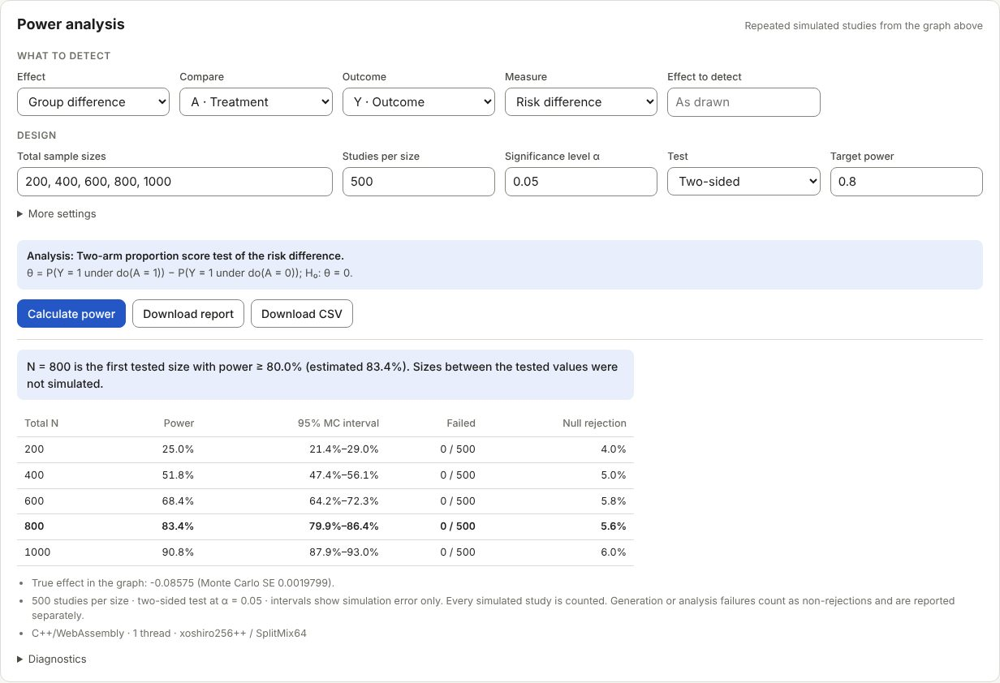

# DAG simulator and power-analysis design

The **Calculator** tab retains its existing formulas, guide and forms. Its C++ /
WebAssembly engine also powers the **DAG simulator** tab, which opens `web/dag.html` and
constructs a data generating process from generic variables. There are no
prescribed covariate, treatment, mediator or outcome roles. A label has no
special effect on the model. A treatment or outcome role is not required to
generate data. The **Power analysis** panel names the comparison to detect by
selecting generic variables for it.

## Workflow

The page is one panel, read from top to bottom: the graph and the selected
variable's settings, then **Question**, then **Power** and its results. There
are no steps or tabs; every part stays on the page.

1. Pick a design in **Start from** (scenarios grouped by kind of study, from a
   two-group trial to TMLE and stress tests, plus an empty canvas) and press
   **Load**; it replaces the design, and Undo restores it. Add variables with the
   **+ Continuous**, **+ Binary**, **+ Count** and **+ Event time** chips (click
   one, or drag it onto the canvas where the variable should go; double-clicking
   the empty canvas adds a continuous variable). New variables are placed where
   they overlap nothing.
2. Select the variable and edit its identifier, label, type, distribution and
   parameters. Changes apply as you make them; Enter applies a typed value at
   once.
   Renaming updates arrows, interactions and censoring references.
3. Connect variables by dragging from a box's plus port onto another box, or
   by clicking the port and then the other box, or with **Add** under *New
   arrow into …* in the selected variable's settings, which offers only parents
   that keep the graph acyclic. While an arrow is being drawn, boxes it could
   reach are outlined and the others are dimmed, with the reason (a cycle, an
   existing arrow, a finer level affecting a coarser one) shown on hover and in
   the status line. An arrow adds a parent term to the child's conditional
   predictor. Click an arrow to select it (Delete removes it, or use its ×),
   select the child to edit coefficients or add interactions between two
   parents. **Tidy layout** arranges the graph left to right in generation
   order, keeping each study level together. **Clear** removes every variable,
   arrow and study level, resets the question and the analysis settings, and
   leaves an empty canvas; one Undo restores the model.
4. Read the graph and the conditional equations below it. A box has two
   lines: the variable's label, then its identifier and distribution, with a
   root variable's parameters (`X · N(0, 1²)`, `A · P(1) = 0.5`) and otherwise
   the distribution's name (`Y · Normal`). Hovering a box shows the rest: its
   type, the scale its incoming coefficients act on, censoring, its inferred
   role and a summary of 2,000 draws of the current model (seed 1). The
   selected variable's settings sketch those draws, redrawn a moment after each
   change: a histogram, the share of 1s for a binary variable, or the survival
   curve of an event time. A box's plus port appears when it is pointed at or
   selected (always on touch screens). Click the number on an arrow (or press Enter on a focused arrow) to
   change its coefficient in place. Right-click a box, press C or O on it, or
   use the *Compared* / *Outcome* buttons in its settings to make it the power
   analysis's compared variable or outcome; the two swap if needed. The
   power analysis's variables are tagged on the graph, and the arrows that
   carry the tested effect are highlighted.
   **Paths from A to Y**, under the graph, lists every path between the
   compared variable and the outcome (up to 40) as causal, back-door or other
   non-causal, and whether the planned analysis leaves it open or blocks it (at
   a collider, or by adjusting for a variable); hovering a path marks its
   arrows. An open non-causal path is flagged because it would mix
   confounding into the estimate. **Simulate one dataset**, folded away under
   the graph, generates one seeded dataset, summarizes every column and downloads
   it as CSV.
5. In **Question** and **Power**, below the graph, choose what to detect (a group difference or a
   regression coefficient, the variable compared, the outcome, the measure, a
   time horizon for survival measures and an optional effect to detect) and the
   design (total sample sizes, studies per size, alpha, the test's sides and
   target power), then **Calculate power**. The panel starts from a runnable
   choice and shows the analysis it will fit, with notes on what it assumes,
   as you edit. Next to **Effect to detect** it shows the effect the model
   implies (the arrow's coefficient for a coefficient target; otherwise a
   population simulation of 5,000 draws, marked ≈), which a blank field uses.
   When the automatic analysis is an unadjusted two-group test although other
   causes of the outcome are drawn, it says so and points to g-computation or
   AIPW.
   Null value, seed, calibration and the null-scenario check
   are under **Analysis details and formal target** and **Simulation settings
   and null checks**. Inspect uncertainty and failed fits.
6. Export/import the design as JSON. The graph, estimand and power settings are saved in browser storage
   when available. Undo/redo supports 50 edits. A deleted or replaced model
   can be recovered with Undo.

Drag nodes or move them with keyboard arrow keys. All model editing is also
available through the variable settings. The canvas scrolls on small screens.

The canvas pans when its background is dragged and zooms with the − / + / fit
buttons in its corner, Ctrl/⌘ + mouse wheel or a trackpad pinch. Shortcuts:
Ctrl/⌘ + Z undoes and Ctrl/⌘ + Shift + Z (or Ctrl + Y) redoes anywhere outside a
text field; on the canvas F fits the graph, + and − zoom, ? lists the
shortcuts, Delete removes the selected box or arrow, C and O set the compared
variable and the outcome, and Escape cancels an arrow being drawn. A banner
over the canvas lists what needs attention: no comparison chosen yet, a
question the planned analysis cannot answer, open non-causal paths (whose
arrows are drawn in orange) and variables with no arrows. When a comparison is
set, a box that is a confounder, mediator or collider relative to it is
labelled so; every inferred role (also instrument or prognostic) is in the
box's tooltip. Saved positions may lie
anywhere within 3600 × 2400 canvas units; versions of the page before this
limit accept only 920 × 440.

## Distributions

For each variable the predictor is `eta = intercept + sum(beta * parent)` plus
explicit pairwise products and optional transformed response terms (below). Coefficients use the parents'
original units. All generated variables can be parents, subject to acyclicity.

| Type | Distribution | Conditional parameters |
| --- | --- | --- |
| Continuous | Normal | Mean `eta`, positive residual SD |
| Continuous | Uniform | Center `eta`, positive width; endpoints `eta ± width/2` |
| Continuous | Log-normal | Mean of log values `eta`, positive SD of log values |
| Continuous | Gamma | Mean `exp(eta)`, positive shape; scale `exp(eta)/shape` |
| Continuous | Student t | Center `eta` plus scale × t with `df > 1` degrees of freedom (heavy tails; variance `scale² df/(df − 2)` when `df > 2`) |
| Continuous | Beta (proportion) | Values in (0, 1) with mean `logistic(eta)` and precision `φ`: variance `mean (1 − mean) / (1 + φ)` |
| Binary | Bernoulli | Success probability `logistic(eta)` |
| Count | Poisson | Mean `exp(eta)` |
| Count | Negative binomial | Mean `exp(eta)`, overdispersion `α`: variance `mean + α mean²` (a gamma-mixed Poisson) |
| Survival time | Weibull | Positive shape `k` and baseline scale `s`, with `S(t | parents) = exp(-(t/s)^k * exp(eta))` |
| Survival time | Exponential | Weibull with shape fixed at 1 |

Survival parent coefficients are log hazard ratios in this version. A positive
coefficient shortens event times. The survival inverse transform is evaluated
on the log time scale. Log-normal is a positive continuous variable; it can
also supply censoring times. Other survival parameterizations and categorical
distributions can be added to the distribution registry in later work.

Analyses treat a Student t variable with least squares (a Normal working model
in the g-formula), and fit a Beta or negative binomial mean by quasi-likelihood
(logistic or Poisson regression) with a sandwich covariance; the g-formula
redraws them with moment estimates of the precision or overdispersion. The
parameters `df`, `precision` and `overdispersion` are saved only on variables
whose distribution uses them.

**Unmeasured variables.** Clear *Measured in the study* in a variable's
settings (or use *Mark as unmeasured* in its menu; JSON `"measured": false`) for
a variable that is simulated but recorded by no study: an unmeasured
confounder, the true value behind an error-prone measurement, a hidden class
such as responders or structural zeros. It is drawn dashed, with "unmeasured"
on its box, and stays in simulated datasets. No analysis uses it: a model term
on it is replaced by linear terms in the measured variables it is generated
from (through other unmeasured ones), so a confounder with no measured causes
is simply not adjusted for, and a mediator's model uses the compared variable
in its place. The compared variable, the outcome and the visit time must be
measured, and custom analysis terms cannot name an unmeasured variable. The
plan notes which unmeasured variables affect the outcome; the true effect still
comes from the full model, so the Checks column shows the bias, coverage and
false positives they leave. Adjusting for a recorded proxy (a child of the
unmeasured variable) is a choice made in the planned analysis's terms, not
automatic.

Exogenous draws are independent across variables and rows. Dependencies arise
through parent terms and shared ancestors. Roots are independent unless an
explicit ancestor is introduced. Variable labels do not enforce randomization
or determine an adjustment set. Interactions apply on the child's predictor
scale; main coefficients then apply when interacting parents equal zero.

## Nonlinear response functions

Select a child variable and open **Response curves**. Its existing arrows
remain linear terms. Additional terms support:

| Function | Definition and parameters |
| --- | --- |
| Quadratic | `((x - center) / scale)^2`, with positive scale |
| Threshold | `1{x > knot}` (strict inequality) |
| Hinge | `max(0, x - knot)` |
| Saturation | `tanh((x - center) / scale)` |
| Restricted cubic spline | 3–7 fixed, increasing knots in original units; one linear arrow plus `K - 2` nonlinear components |
| Logarithm | `log(x)` for a positive parent; a value of zero or less stops the simulation. With coefficient 1 on a count's log follow-up time it is an offset |

A response term can multiply two transformed parents, including the same
parent. Both variables must already have arrows into the child. Terms are
explicit data, never expressions evaluated as code. Duplicate terms are
rejected; other linear dependencies (e.g., a binary variable and its square)
can still make a planned regression unidentified and are reported as failed
fits. Terms survive JSON export/import, renaming and Undo; removing a parent
arrow removes its dependent terms.

For example, add this to a node to generate a quadratic effect and a nonlinear
interaction:

```json
"functions": [
  {"left": "X", "transform": {"kind": "square"}, "coefficient": 0.7},
  {"left": "X", "transform": {"kind": "saturation", "center": 0, "scale": 1},
   "right": "A", "coefficient": 0.3}
]
```

A spline component is `{"kind":"spline","knots":[-2,-1,1,2],"index":0}`.
The JSON index is zero-based (the editor shows one-based components). For
knots `k1 < ... < kK`, component `j=1,...,K-2` is
`[(x-kj)+^3 - (x-k(K-1))+^3 (kK-kj)/(kK-k(K-1)) +
(x-kK)+^3 (k(K-1)-kj)/(kK-k(K-1))] / (kK-k1)^2`.
Both tails are linear; the upper tail is evaluated directly to avoid
cancellation. The linear arrow is a separate coefficient.

**Preview the conditional response** plots the implied mean, probability or
hazard multiplier as one parent varies. Other parents are held at the
editable values shown (initially zero); this is a conditional slice, not a
marginal effect or a simulated dataset. Built-in examples demonstrate a
U-shaped dose response, nonlinear confounding, and a zero average effect
with heterogeneous subgroup effects.

## Relationships of unknown form

Every term above makes the predictor a fixed combination of known functions:
`g(E[Y | parents]) = Σ β × term`, linear in its coefficients however curved the
terms or the link. A variable can also carry a relationship of **unknown
form**: open **Relationship of unknown form** in its settings, tick the
parents it involves, and set

- **Size**: the SD, over the population, of the function's contribution on
  the variable's predictor scale (log odds, log mean, log hazard, or the
  variable itself);
- **Smoothness**: roughly how many SDs of a parent one bend spans (1 wiggly,
  2 moderate, 3 gentle).

The engine draws a smooth random function of the ticked parents jointly (so
they interact in an arbitrary way): 64 random Fourier features of a Gaussian
process with a squared-exponential kernel on the parents standardized by
their population mean and SD, then centred and scaled to the given SD. The
standardization comes from a pilot draw of the model (4,000 rows, a fixed
seed) and is carried into the scenarios the engine derives from the graph, so
the null and calibrated scenarios keep the same function; in the null
scenario the compared variable is held at its reference level inside it.
**Draw another shape** changes the shape number (the function's seed). The
JSON is `"unknown": {"inputs": ["X1", "X2"], "size": 1, "smoothness": 2,
"seed": 5}` on the variable; the relationship's arrows show `?` and its
equation `+ f(X1, X2) [unknown form, SD 1]`.

No analysis is told the shape: planned terms (including *Match the generating
terms*) contain only the known terms, and a coefficient or joint test of an
effect whose form is unknown is refused. The true effect still comes from
simulating the full model, so the Checks column shows what a wrong form costs.
When the compared variable's or the outcome's model has a relationship of
unknown form and the comparison would use AIPW, **Automatic** analysis uses
TMLE with Super Learner nuisance models and 3-fold cross-fitting instead (see
*Super Learner nuisance models* below); the two-arm tests of a randomized comparison model no covariates and
stay valid.

## Survival observations

A survival variable `T` always generates its latent event time. Its optional
observation rule uses no censoring, a positive administrative cutoff, or a
different generated variable `C` as the censoring time. The simulator then adds:

- `T_time = min(T, C)`
- `T_event = 1{T <= C}`

Without censoring, `T_time` equals `T` and all event indicators equal one.
Censoring variables must generate nonnegative values; invalid realizations
stop the run rather than being clipped. Every survival variable gets its own
observed time and indicator columns, including an uncensored survival variable
used as `C`. A derived column cannot conflict with another variable ID.

The censoring observation rule is separate from hazard dependencies: choosing
`C` as a censoring variable does not add an arrow into `T`'s hazard model.
The graph can separately specify shared ancestors or an arrow between `T` and
`C`. Consequently, independent censoring is a modeling choice, not a guarantee
of this flexible interface. Observation columns are outputs and cannot be
parents in the same simulation. Removing `C` resets affected observation rules
to uncensored; Undo restores them.

## Executable model contract

`dag-model.js` provides editor validation, graph transformations and displayed
equations. All data generation, population-effect evaluation, calibration, model
fitting, hypothesis tests and power aggregation execute in `core/src/dag/`,
compiled into the calculator’s existing `ssc_web` and `ssc_web_mt` engines. A JSON graph contains `version: 1`, `nodes` and `edges`. Each node has:

- `id`, `label`, `kind`, `family`, `intercept`, `interactions`, `x`, `y`
- Distribution parameters such as `sd`, `width`, `shape` and `scale`
- For survival: `censoring: {mode, time, variable}`

Arrows have `{source, target, coefficient}`. A node may also have a `functions` array of explicit transformed terms. Interactions on a child have
`{left, right, coefficient}`, using two different existing parents. Deleting a
parent arrow also deletes interactions that depend on it. Renaming a variable
updates all references. Unknown imported fields are discarded, never executed.
IDs contain at most 32 letters/digits/underscores, start with a letter and are
unique. Labels can have up to 80 characters. Empty graphs can be edited and
saved but require at least one variable before data generation.

The graph supports 40 variables and 1–50,000 observations, with uint32 seeds.
Poisson means must be representable and in `(0, 1000]`; extreme parameters that
produce overflow or underflow stop with an error rather than clipping. Sampling uses the calculator’s xoshiro256++ generator with SplitMix64 streams,
Marsaglia polar Normal draws, Marsaglia–Tsang Gamma draws, inverse transforms
and exact Poisson additivity. Streams are indexed by seed, replicate, scenario,
variable ID and subject. Paired interventions reuse the same exogenous draws;
mediators respond through their structural equations. A larger study contains
the same first subjects, and reordering or repositioning nodes does not change
draws. Changing a variable ID selects a different stream. Fixed seeds from the
former JavaScript prototype will generate different datasets with this engine.

The `ssc_dag_json(request, token)` C API returns `{ok, result}` or `{ok: false,
error}`. Operations are `simulate`, `plan`, `population`, `calibrate`, `analyze`,
`nullGraph` and `power`. Each request contains `graph`; target-related operations
also contain `estimand`. `power` accepts `settings` and optional `threads`
(0 selects the available cores); `simulate` accepts `options: {n, seed}`.
Every request is independently validated in C++. The browser’s method hint
cannot override the estimator selected by the engine.

The same `Engine` and `worker.js` used by the calculator load WebAssembly in a
background worker. A cross-origin isolated page uses the pthread build; other
pages or failed threaded starts use the single-thread build. Replicates use the
calculator’s C++ thread pool and are reduced in replicate order, so changing
thread count does not change results. A memory budget limits concurrent fit
workspaces. Progress is posted between native batches; Stop terminates the
worker. There is no JavaScript simulation or numerical-analysis fallback.

The exported design envelope is `{version: 1, graph, estimand, power}`. The graph uses
the contract above; `estimand` holds the power panel's target (null while the
graph has fewer than two variables). `estimand-model.js` validates the target
independently of data generation. Standalone graph files can still be imported.
Renaming a variable updates the target's references; a graph change that makes
the target invalid replaces it with the panel's default and says so. Undo
restores both the graph and the target. Target choices never add/remove arrows
in the drawn graph. The target selects a compatible executable analysis, shown
before calculation.

Data generation runs in a cancellable module worker. Structural edits and
simulation input changes invalidate results and stop pending work. JSON export
contains the structural model; sample size and seed are run inputs shown with
the result. CSV includes every variable and derived survival observation column.

## The power target (estimand)

The target is distinct from the estimator or analysis used for power. The panel
supports three target types:

- **Group difference** (a marginal total-effect contrast): intervention levels for a selected
  variable, with a difference in means, binary risk difference/ratio or marginal
  odds ratio, survival probability difference at a time, or RMST difference.
  Marginal targets integrate over the population specified by the DGP. Mediators
  follow their generating models under each intervention; they are not held
  fixed or automatically included as adjustment variables.
- **Regression coefficient** (a conditional model coefficient): an existing predictor-to-outcome arrow,
  on the child's predictor scale or an exponentiated scale when meaningful.
  With ordinary interactions, the main coefficient applies at zero values of the
  other interacting parents. Nonlinear terms can also contribute to effects and
  derivatives, so the linear coefficient alone is not the full effect. It is not presented as a marginal total effect.

- **Joint test (overall, nonlinearity, interaction)** (a joint conditional regression test):
  `overall_effect` tests all fitted terms involving the selected predictor;
  `nonlinearity` tests only terms nonlinear in that predictor, retaining its
  linear terms; `interaction` tests only the products of the predictor with
  other variables (effect modification), retaining its main terms. Nonlinearity
  is unavailable for a binary predictor. Transformed
  interactions are included when they are nonlinear in the selected predictor.
  The fitted basis defines the hypothesis; this is not a marginal total-effect
  test. The graph supplies the alternative; a scalar effect-size calibration
  is not meaningful for a coefficient block. Joint tests use a sandwich Wald
  chi-square test for nonsurvival outcomes and a model-based Weibull PH Wald
  test for survival outcomes. Both are large-sample tests.

The population is the graph's distribution; the exported target records it as
text, which does not subset or reweight simulated data. A custom text target,
which has no executable analysis, can still be read by `estimand-model.js`; the
panel replaces it with its default. For a binary outcome the panel offers the
risk difference and not the identical mean difference. Survival probability and
RMST targets require a positive horizon (by default the administrative cutoff
or the baseline time scale) and refer to latent event time, independent of the
observation/censoring mechanism. The panel shows the target's formula and null
value under the analysis it selects. Ratio nulls default to one; difference
and coefficient nulls default to zero. A numerical planning alternative calibrates an eligible arrow in a copy of the
DGP before power simulation. Changing the effect measure clears an alternative
entered on the old scale. Leaving it blank uses the graph as drawn.

The target is kept with the design, included in JSON export and undo/redo,
and restored on reopening the design. Changing it does not invalidate generated
raw data, because the DGP itself is unchanged.

## Analysis and power evaluation

The target selects the estimator, test scale, null and survival horizon.
The design adds total sample sizes, repetitions, alpha, a two-sided or
one-sided rejection rule, a seed and target power. Changing the saved target,
graph or settings clears previous results. Every comparison in the graph has
an analysis: the panel names it before the run, with notes on any assumption
the drawn graph does not grant, and only invalid input (such as a risk
difference outside −1 to 1) stops a run.

| Saved target | Analysis fitted to each simulated study |
| --- | --- |
| Marginal mean difference (continuous/count), randomized comparison | Welch t test |
| Binary mean/risk difference | Two-proportion score test at null 0; Wald at a shifted null |
| Marginal risk or odds ratio | Wald test on the log ratio scale |
| Survival probability difference at the horizon | Kaplan–Meier estimate and Greenwood Wald test |
| RMST difference through the horizon | Kaplan–Meier area and its Greenwood covariance variance, Wald test |
| Marginal mean/risk difference, risk ratio or odds ratio, confounded binary comparison | Doubly robust AIPW Wald test (below) |
| Any other marginal target: continuous, count or event-time comparison variable; event-time outcome with a confounded comparison, censoring that shares causes with the event, or a horizon past follow-up | Parametric g-formula Wald test (below) |
| Conditional Normal/Uniform coefficient | Linear regression coefficient t test (approximate for Uniform errors) |
| Conditional Log-normal coefficient | Log-response linear regression t test |
| Conditional Bernoulli/Poisson/Gamma coefficient | Logistic or log-link GLM Wald test; Gamma dispersion estimated from the sample |
| Conditional survival coefficient / hazard ratio | Cox PH Wald test with Breslow ties; ratio targets tested on the log scale |

A binary root variable represents independent randomization and uses the
unadjusted tests above. A binary comparison variable with parents is
confounded, and its power uses the augmented inverse probability weighting
(AIPW) estimator described next. Everything else uses the parametric
g-formula, so continuous, count and event-time interventions run too.

### Independently specifying the planned analysis

In **Question**, choose the estimator and open **Analysis details and formal target** for regression terms
independently of the generating graph. Existing designs default to the
original automatic estimator with matching terms and no cross-fitting.
Selecting g-computation also allows adjusted analyses of randomized binary
comparisons. AIPW and TMLE require a binary exposure and nonsurvival outcome;
TMLE supports binary, continuous and count means and complete repeated-outcome summaries. Incompatible
selections produce an explicit explanation before running.

Term presets are matching generating terms, linear main effects, linear plus
quadratic terms, or restricted cubic splines with fixed user-specified knots.
Binary variables contribute a single linear term. Optional pairwise
interactions use linear parent values. Propensity terms and individual node
models can be overridden separately. Fixed knots use original predictor
units; choose appropriate ranges rather than treating the default -1, 0, 1
as universal. In the JSON API, a `custom` basis accepts an explicit `terms`
list with the same transformations as generating functions, without
coefficients. G-computation disallows conditioning a node on itself or its
descendants; AIPW/TMLE disallow exposure descendants in adjustment models.

The design stores this under `power.analysis`. `plan` and `analyze` requests
accept the same object as a top-level `analysis` argument. For example:

```json
{
  "method": "aipw",
  "basis": "linear",
  "propensity": {"basis": "quadratic"},
  "folds": 5,
  "models": {"Y": {"basis": "spline", "knots": [-2, 0, 2]}}
}
```

An override keyed by the exposure ID takes precedence over `propensity`.
The overall/mediator preset applies to each g-computation model unless its
node is overridden. Numerical coefficients are always estimated anew from
each study; the analysis does not receive generating coefficients.

AIPW/TMLE support 2–10 folds (`folds:1` disables splitting). Folds are assigned
deterministically within exposure arms. Structured TMLE holds out whole independent subjects or clusters, stratifying constant-treatment clusters by arm. Mixed-arm clusters form a separate stratum. Each study refits its propensity and
arm-specific outcome models using training folds only and predicts on held-out
rows. Centering/scaling uses the full covariate matrix, an invertible linear
reparameterization that does not change these unpenalized regression fits.
`propensityBound` defaults to zero (no truncation); a value in [0, 0.5) explicitly clips predictions to [b, 1−b] and reports its use. Truncation may add bias and does not repair lack of overlap. Failed or separated fits remain
explicit failures. Cross-fitting does not guarantee valid inference with
poor overlap, small samples, or misspecified nuisance models.

Binary-outcome TMLE updates the cross-fitted outcome probabilities with two
arm-specific logistic offset fluctuations using inverse propensity clever
covariates. Its treatment-specific means are averages of the updated
probabilities, so they stay within the probability range. Wald standard
errors use the empirical efficient influence function, with delta-method
log-scale inference for risk and odds ratios. This is a finite-basis TMLE;
no automatic machine-learning model selection is performed.

### Super Learner nuisance models

For AIPW and TMLE, **AIPW / TMLE nuisance models** can be *Parametric* (the
terms chosen below it) or *Super Learner* (van der Laan, Polley & Hubbard
2007): a library of the training mean, a main-terms GLM, a GLM with all
pairwise products, additive restricted cubic splines (knots at covariate
quantiles), gradient-boosted depth-2 trees (shrinkage 0.1, the number of
rounds chosen by early stopping on a fifth of the training rows) and kernel
ridge regression on 48 random Fourier features (median-heuristic bandwidth,
penalty by generalized cross-validation). Each learner's 5-fold cross-validated
predictions are combined by non-negative least squares into a convex
combination, and the learners with weight are refitted on the training rows.
Logistic versions model the propensity and a binary outcome. The Super Learner
uses the variables of the planned terms, not their forms; the outcome
regression is one model over both arms with the exposure as a covariate,
evaluated at each level. With cross-fitting each fold's predictions come from
learners fitted on the other folds (CV-TMLE). The diagnostics report the mean
weights each learner received. JSON: `"learner": "superlearner"` in the
analysis. A Super Learner run takes several times longer than a parametric one.

In checks with two standard Normal confounders whose effects on treatment
(log-odds SD 1) and outcome (SD 1) both had unknown form, parametric AIPW was
biased by 0.24–0.32 (true effect 0.3) with 62–75% false positives at n = 500,
while TMLE with the Super Learner had bias −0.003 to 0.02, coverage 0.92–0.94
and 5–8% false positives for smoothness 2. For wiggly functions (smoothness 1)
its bias was 0.08 at n = 500 and 0.04 at n = 2,000: flexible estimation needs
enough data for the shapes it must learn, and the power analysis shows when it
does not.

### Confounded comparisons (AIPW)

When arrows enter the comparison variable `A`, each simulated study is
analyzed with the doubly robust AIPW estimator (Robins, Rotnitzky & Zhao
1994; Bang & Robins 2005):

- **Adjustment set.** The parents of `A`, which block every back-door path in
  the drawn DAG because all of them are generated and observed, plus the
  outcome's parents that `A` does not affect, which add precision. Mediators
  and other descendants of `A` are never adjusted for. A parent of `A` that is
  a censored event time is used at its latent value, with a note that a real
  study could not see it.
- **Propensity model.** Logistic regression on the independently selected
  exposure terms. The default matches the generating terms (including
  nonlinear functions), so it is correctly specified by construction in that
  default. A different analysis basis can deliberately misspecify it.
- **Outcome model.** Within each arm, a regression of the outcome on the
  adjustment set, including matching nonlinear functions and interactions.
  Exposure interactions such as `A * X²` supply `X²` to the separate arm models,
  even without a standalone `X²` term. Fits use least squares for Normal and Uniform outcomes, logistic for
  Bernoulli, Poisson log-link for counts, and Gamma log-link for Gamma and
  Log-normal outcomes. It may be misspecified; the estimator remains
  consistent if the propensity model is correct, under positivity and the
  usual regularity conditions. Alternatively, a correct outcome regression
  supplies consistency when the propensity model is misspecified. Neither
  double robustness nor cross-fitting by itself guarantees Wald coverage
  under every single-model misspecification scenario.
- **Inference.** The standard error is the empirical SD of the estimated
  influence function over `sqrt(n)`, with a normal reference distribution.
  Risk and odds ratios are tested on the log scale by the delta method.
  Propensities are not truncated. Poor overlap shows as larger standard
  errors; a study whose propensity fit separates the arms or reaches 0 or 1
  fails (`positivity` or `nonconvergence`) and counts as a non-rejection.

Influence-function standard errors are slightly small in small samples, so
the null rejection rate can exceed alpha by about a percentage point at a
few hundred subjects. Keep **Also simulate a reference/null scenario** on
to see it. Event-time outcomes with a confounded comparison use the
g-formula instead, which adjusts for confounding and censoring together.

### Every other comparison (parametric g-formula)

The g-formula (Robins 1986) refits the specified conditional model for the
outcome and for every variable the comparison variable `A` affects on the way
to it (the mediators), each on its specified terms (the parents, interactions
and nonlinear functions by default), by maximum
likelihood: least squares with an estimated SD for Normal, Uniform and
Log-normal (on the log scale) variables, logistic, Poisson and Gamma GLMs, and
a Weibull proportional-hazards fit to observed time and event status for event
times (Exponential holds the shape at 1). Every other variable keeps its
observed values. The estimate averages the outcome's mean, risk, survival at
the horizon or RMST to the horizon over the study's rows with `A` set to each
level; mediators are drawn from their fitted models with common random numbers,
`ceil(1000 / n)` draws per row, at most 20. Conditioning each model on its
parents identifies the target in the drawn DAG whatever the type of `A`, and
censoring by a variable that shares causes with the event is ignorable given
the event time's parents. The standard error adds the rows' variation to the
fitted parameters' (a delta method evaluated at ± one Cholesky column of each
model's covariance); ratios are tested on the log scale.

When the drawn graph does not grant what an analysis needs, the run goes
ahead and the panel and report say so:

- a censored event time used as a covariate enters at its latent value;
- censoring caused by the event time itself biases every analysis of the
  observed data, and the results show that bias;
- a horizon past administrative follow-up is reached by extrapolating the
  Weibull model;
- with no arrow path from `A` to the outcome the effect is zero, so the
  rejection rate is the test's false-positive rate, and an effect to detect
  cannot be set (the run keeps the drawn model and says so);
- an outcome upstream of `A` cannot be changed by it: the contrast is zero by
  construction and no study rejects.

Conditional analyses fit all outcome parents and specified interactions,
retaining the selected structural coefficient. Rank deficiency, separation and
nonconvergence are explicit failures. No true DGP variance or coefficient is
substituted for an estimated standard error.

Survival fits use observed time and event status, never latent outcome values.
Kaplan–Meier is used only when censoring shares no causes with the event
beyond the arm and follow-up reaches the horizon; otherwise the g-formula
takes over. Within a replicate, a positive KM curve is not extended beyond the
last observed follow-up; insufficient follow-up is reported as an analysis
failure. Normal/Wald approximations still require adequate sample sizes and
events.

### Alternative and null DGPs

Marginal effects are evaluated by paired `do(A=active)` and `do(A=reference)`
population simulations. Calibration adjusts a selected arrow on a directed path
to the outcome using bracketed search. Mediated paths are included: for the
mediation example, the total mean difference is `0.3 + 0.8 * 0.6 = 0.78`.
Targeting 0.5 therefore adjusts the direct arrow toward 0.02, not 0.5. A separate
random stream verifies the resulting effect and reports population Monte Carlo
uncertainty. A target the selected arrow cannot reach within its bounds stops
the run with the bounds to widen. Conditional
coefficient calibration is exact (log transform for an exponentiated target).
The graph stays as drawn; the report includes the actual alternative graph.

The default reference is the marginal no-effect null. For this null, every exposure effect on causal paths
to the outcome, including interactions involving the exposure, is zeroed.
Other paths and observation rules remain. This handles mediated effects rather
than zeroing only the direct arrow. Conditional nulls set the selected
coefficient. Shifted marginal nulls are Monte Carlo calibrated and labeled
approximate reference scenarios, with their effect uncertainty exposed.

The alternative **Calibrate the contrast; retain other effects** reference
changes one selected linear arrow to reach the null contrast while preserving
all other terms. It can retain nonzero subgroup effects when their population
average is zero. This reference is Monte Carlo calibrated and independently
verified, so the report calls it approximate and reports its remaining effect
and uncertainty. Rejection is only interpretable relative to that verified
reference; finite calibration error is not evidence of type I error failure.
A requested reference outside the selected arrow's reachable range fails
explicitly. For joint tests, the selected generating coefficient block is
zeroed while other terms remain; under misspecified analysis this need not be
a null for the working-model coefficient block.

### Results and reproduction

Power is rejections divided by **all** simulated studies. Failed generation or
analysis remains in the denominator as non-rejection, with failure reasons and
counts shown. Results include pointwise 95% Wilson Monte Carlo intervals,
Monte Carlo SEs, mean estimates, empirical SDs, mean test-scale SEs and optional
null rejection rates. Scalar targets also report bias and confidence-interval
coverage at the known generating target, among valid fits. The interval level
is `1 - alpha`, even for a one-sided power test. Bias is on the reported effect
scale; coverage uses the test scale (log for ratios). Joint tests have no
single effect estimate or interval coverage.

The results open with an answer. When the target power lies between two tested
sizes, the page estimates the size that reaches it by interpolating linearly in
probit power against log size between those two sizes, labels it as an estimate
that was not simulated, and offers to simulate three sizes around it (85%, 100%
and 115% of the estimate) with one click; repeating narrows it further. When
every tested size already reaches the target, or none does, it offers smaller
(⅛, ¼, ½ of the smallest) or larger (2, 4, 8 times the largest) sizes. The
engine's own `firstTestedN`, the first tested size whose point estimate reaches
target power, is unchanged and is still marked in the table.

Each tested size is checked, and the **Checks** column flags it when the
evidence is clear against the simulation's own Monte Carlo error:

- *type I error*: the null scenario's 95% interval lies entirely above α;
- *coverage*: interval coverage below `1 − α` by more than three binomial
  standard errors (with at least 50 valid fits);
- *bias*: mean bias above 10% of the effect and above three Monte Carlo SEs
  (not judged for ratio measures, whose bias is reported on the ratio scale);
- *failures*: more than 5% of the size's simulated studies failed.

When a size the answer relies on is flagged, the answer is marked "not reliable
yet", the refine button is withheld and the reasons are listed: power from a
test that over-rejects, or from biased estimates, overstates what a study would
achieve. **Text for a protocol or grant** gives a paragraph with the question,
assumed effect, analysis, α, number of simulated studies and seed, every tested
size's power and interval and the null rejection rate, ready to copy.

Download the complete JSON report or the power table as CSV. The JSON is a
superset of the design envelope, with the original graph, saved estimand,
settings, calibrated graphs, verified effects, analysis and engine metadata,
results and diagnostics. It can be reimported as a design. Reproduction uses
the same engine version, seed and settings; floating-point library differences
may produce small differences between native and WebAssembly builds.
Structured studies are explicitly selected through the study specification below; no grouping or repeated measurements are inferred from variable labels.

Method references: [R survival Cox documentation](https://stat.ethz.ch/R-manual/R-devel/library/survival/html/coxph.html),
[R survival methods](https://cran.r-project.org/web/packages/survival/vignettes/methods.pdf),
[Emscripten pthreads](https://emscripten.org/docs/porting/pthreads.html).

## Validation

`npm test --prefix web` checks analytic Normal mediation moments and effects,
Bernoulli probabilities, Poisson moments, Uniform/Log-normal/Gamma distributions,
Weibull/exponential conditional survival probabilities, both censoring rules,
interactions, arbitrary variable-only DAGs, graph validity, renaming, seeded
reproducibility, JSON/CSV interchange and input rejection. Estimand checks cover
total versus conditional targets, ratio/difference nulls, survival horizons,
comparison levels, custom targets, renaming and saved-design round trips.

`web/tests/canvas.test.mjs` checks the canvas geometry and editing helpers:
nested plates and shared-effect placement, moving variables between levels,
turning levels on and off, layered layout, free placement, which arrows a
drag may draw (matching the model's own checks), inferred roles and zoom
arithmetic. The site tests exercise the separate page, cycle checks, drag-to-connect and the undo shortcut,
the nested plates of a clustered repeated design, editing, simulation,
CSV/JSON downloads, survival and censoring, offline use and return to the
calculator. Both pages and their assets are versioned and cached; each page
retains its own Content Security Policy. The DAG page uses the same C++/WebAssembly engine loader, thread fallback and
offline cache as the calculator. Its policy permits WebAssembly compilation.

The C++ tests check independent NumPy/SciPy fits for seven model families,
KM/RMST variance, invalid and singular analyses, native cancellation and
identical one-thread/four-thread power results. AIPW estimates, standard
errors and p-values match an independent NumPy implementation for Normal,
Bernoulli (risk difference, risk ratio, odds ratio), Poisson and Gamma
outcomes; simulated AIPW power under confounding recovers the total effect
of a mediated exposure and holds its type I error. `web/tests/nonlinear.test.mjs` checks explicit function values, spline tails,
transformed interactions, independent analysis plans, U-shaped signals,
misspecified regressions, cross-fitted AIPW/TMLE, interval coverage and
heterogeneous average-effect nulls. The site tests exercise curve editing,
previewing, export, analysis Undo, TMLE and joint tests. The web tests call the real
WebAssembly engine for distribution checks, calibration, null construction,
survival observation handling, power curves and saved-report reproduction.

## Preview




## Subjects, visits and clusters

Switch on **Repeated visits** or **Clusters** in the toolbar; each adds a plate
to the graph. **Study settings**, under the graph, then holds the visit times,
the subjects per cluster and the observation process (also editable by clicking
a plate's label). Specify strictly increasing visit times. A single time supports a clustered
cross-sectional design. Times may be irregular, but the schedule is shared by
subjects. The optional **Subjects per cluster** field is either one cluster size
or a repeating size pattern such as `8, 12, 16`. Without clusters, sample size
counts subjects. With clusters, it counts independent clusters; reports also show
total subjects and scheduled measurement rows. Size patterns are fixed and not
informative about outcomes. Crossed groups and informative/random cluster sizes
are not implemented.

The same structure can be built on the canvas. The **Clusters** and **Visits**
toggles above it add or remove the level (starting from visits at 0, 3, 6 and
12 and clusters of 10 subjects). Each level is drawn as a nested plate,
outermost first: *Every cluster*, *Every subject*, *Every visit*. A plate's
label shows the cluster sizes or the visit times; click it to edit them in
place. Dragging a box into another plate changes where it is measured (also
offered on its right-click menu), and an empty visit plate appears beside the
others as a drop target when nothing is measured at every visit yet. Shared
effects are drawn as circles on the edge of their plate with arrows into the
variable they act on: *u₀* (subject intercept) and *u₁* (subject slope) on the
visit plate, *v* (cluster intercept) on the subject plate; clicking one opens
its setting. Lagged relationships are dashed arrows labelled with the lag and
coefficient, a loop for a variable's own past. Turning a level off moves its
variables to the subject level and clears settings that only apply there.

Every variable now has **Measured at**:

- **Once per subject**: generated once and retained across that subject's visits.
- **Once per cluster**: generated once and retained across all members and visits.
- **At every visit**: generated from its conditional distribution at each visit.
- **Visit time**: a deterministic value from the schedule. This is a continuous
  Normal root in the saved schema, but its distribution parameters are not used.

Arrows may go from coarser to finer levels, or within a level. A subject-level
variable cannot depend on a visit-level variable without a separately defined
aggregation. Existing nonlinear response terms and interactions work with time,
so a treatment-by-time term can specify a changing treatment effect. Variable
names still impose no scientific role. The compact graph labels each scope;
**Expand the DAG across visits** displays the unrolled variables, shared
ancestors, and dashed lagged relationships. Same-visit arrows must remain acyclic.
Lagged arrows can connect a variable to itself at an earlier visit. The
cross-sectional path/adjustment display is hidden for structured studies.

For a visit-level variable, **Subject intercept SD**, **Subject slope SD**,
**Intercept–slope correlation**, and **Cluster intercept SD** add Gaussian random
effects on its conditional predictor scale. Slopes use time since the first
scheduled visit. Different variables have independent built-in random effects;
to generate shared dependence across outcomes, draw a subject- or cluster-level
variable and connect it to both outcomes. Built-in latent random effects are
never supplied to an analysis as measured covariates.

For Normal and log-normal errors, **Residual correlation per time unit** is
`rho` in `[0, 1)`, giving correlation `rho^abs(t_j - t_k)`. Normal innovations
are generated recursively using the actual time gaps. This is a continuous-time
exponential correlation, distinct from lagged outcome effects. For log-normal
variables it acts on log errors. Repeated Bernoulli, Poisson, Gamma and Uniform
variables can use shared predictor-scale random effects; arbitrary observed-scale
ICC values are not automatically imposed. Survival variables are supported at
subject or cluster level for data generation, but recurrent-event processes and
structured survival estimators are not implemented.

An explicit lag `{source, lag, coefficient, initial}` adds a previous visit's
value to the conditional predictor. `lag` counts visits, not time units. The
`initial` value is used whenever the source visit precedes the schedule. The
same structural equation and family apply at every visit; time nodes and their
nonlinear functions can change its conditional mean. Subjects/visits/cluster
membership and lag settings survive JSON export/import, renaming and Undo.

### Observation process

The first visit is observed. Subsequent missing-visit probabilities follow

`logit P(missing) = intercept + historyCoefficient * last observed history value
 + currentCoefficient * current latent history value
 + treatmentCoefficient * treatment value`.

**Monotone dropout** makes all later visits missing after the first missed visit.
**Intermittent missing visits** allows observation to resume. The same visit mask
applies to all visit-level variables. Zero history/current coefficients allow
noninformative missingness within treatment arm. A history coefficient can
represent observed-history-dependent missingness; a current-value coefficient
permits MNAR sensitivity scenarios. Underlying values continue to evolve after a
missed visit, including through lagged relationships.

Long-format output contains zero-based `subject_id`, `cluster_id`, `visit_index`,
and `visit_time`. A repeated variable `Y` has latent/generated `Y`, binary
`Y_observed`, and `Y_recorded`, which is null/blank when unobserved. Summary
statistics describe generated values. Analyses use only rows with the outcome's
observation indicator equal to one, never its unobserved values. The `analyze`
API validates identifier order, scope consistency and observation indicators.

### Trajectory estimands and planned analyses

The repeated target is a weighted contrast of marginal visit means,
`sum_j w_j {E[Y_j under do(A=active)] - E[Y_j under do(A=reference)]}`.
Supported choices are selected visit, equal-weight average over all scheduled
visits, change from first to last, difference in linear trend, and custom
weights. The linear-trend weights are `(t_j - mean(t)) / sum_k (t_k - mean(t))^2`:
this defines a projection contrast even if the trajectory is nonlinear. An
average excluding baseline is a custom contrast with baseline weight zero.
Binary outcomes use marginal risk-difference contrasts, not conditional odds
ratios. Population evaluation uses the same contrast and paired interventions,
with Monte Carlo uncertainty calculated across independent subjects or clusters.
Subjects receive equal weight in the target, including with unequal clusters.

Structured power requires a binary baseline subject- or cluster-level exposure.
MMRM, LMM and trajectory means require randomized assignment. Complete-summary
TMLE also permits measured baseline confounding. The graph may contain visit
variables, mediators and lags, but the target is the total effect of baseline
assignment. Time-varying treatment, dynamic regimes, mediation-specific effects,
crossed random effects and joint trajectory tests need further estimators.

| Planned estimator | Scope and assumptions |
| --- | --- |
| MMRM | Continuous repeated outcome, independent subjects, up to 12 visits, complete data or monotone dropout. Fits arm-by-visit means and a common unstructured covariance using the existing MMRM fitter. The t reference uses last-visit sample count minus two; it is not Kenward–Roger. |
| Linear mixed model | Continuous repeated outcome, independent subjects. Separate arm-by-visit means for 2–6 visits, or arm-specific linear trends for 2–12 visits. Subject random intercept, optional correlated random slope, independent residual errors; REML and Satterthwaite inference with the existing fallback when needed. Allows intermittent missing visits. |
| Complete-summary TMLE | Continuous, binary or count outcomes, with complete contributing visits and baseline binary treatment. Subject-weighted effect, baseline adjustment, whole-unit cross-fitting and a cluster influence-function variance. No missing-data or time-varying treatment adjustment. |
| Trajectory means | Continuous, binary or count outcomes, independent subjects or nested clusters. Arm-by-visit available-case means and a CR1 sandwich at the highest independent unit, with units-minus-two t degrees of freedom. Validity relies on enough independent units and noninformative missingness within arm and visit. |

The automatic choice is MMRM for continuous visit-level outcomes with independent
subjects, more than one visit and no intermittent missingness; otherwise it is
trajectory means. The planned model can differ from the generator. The LMM's
time model and random slope are independently selected. Likelihood analyses
rely on their mean/covariance assumptions and ignorable missingness; available
case means can be biased under history-dependent dropout. Bias, coverage,
failures and null rejection remain visible in the results. Convergence failures
remain in the power denominator as non-rejections.

Sample-size rows represent independent subjects or clusters, never measurement
rows. Replicate RNG streams are independent of thread scheduling. Each study is
limited to 50,000 scheduled measurement rows. Population simulations process
bounded batches. The existing effect calibration changes an eligible linear
arrow; some contrasts, especially a pure slope contrast with an additive
intercept arrow, are insensitive to that parameter. Such calibration reports
unreachability rather than changing the target. Edit the treatment-by-time term
and use the graph-implied alternative for that case.

### Power and parametric assumptions

The generating scenario specifies the distributions, response functions,
random effects, dependence and observation mechanism. The power calculation is
the rejection probability under that scenario. A semiparametric or robust
estimator does not make the power calculation independent of those assumptions.
No true generating variances are used in fitted standard errors. Monte Carlo
intervals quantify simulation error conditional on the scenario, not uncertainty
about the scenario. Compare plausible generating scenarios independently of the
planned analysis; this version does not integrate an elicited prior over
unknown generating parameters or implement empirical resampling from pilot data.

The Study catalog has 44 categorized scenarios, including six TMLE examples and stress tests for rare events, weak overlap, few clusters, skewed outcomes and missingness. Common designs add a baseline-adjusted (ANCOVA) outcome, a 2 × 2 factorial trial, a one-sided non-inferiority comparison and an effect-modification (interaction) test; *Repeated and clustered* adds a cluster randomized trial with one measurement per patient; *Outcome types* covers staggered entry with a common end date, overdispersed counts, event rates over unequal follow-up (a log offset), heavy-tailed and proportion outcomes; *Unmeasured variables* covers unmeasured confounding, a confounder measured with error (adjusting for its recorded proxy), zero-inflated counts from an unrecorded never-at-risk class, and unrecorded responders; *Unknown forms* covers confounding of unknown form (TMLE with a Super Learner) and a randomized effect varying in an unknown way. `web/tests/scenarios.test.mjs` loads every scenario and checks that the page's analysis plan matches the engine's. Every scenario loads a graph, question and power settings together. The coverage table distinguishes estimator support from sensitivity scenarios and unsupported designs. `web/tests/study.test.mjs`
checks analytic covariance at irregular times, independent complete-data
contrast/variance calculations, LMM trend estimates, cluster influence-function
variance, missing-outcome exclusion, calibration and null effects, unit counts,
thread reproducibility and simulated coverage/null rejection.

### Continuous and complete-summary TMLE

Unbounded continuous/count TMLE fits arm-specific least-squares initial
regressions, then an identity fluctuation `Q*_a = Q_a + epsilon_a / g_a`.
Its least-squares score gives
`epsilon_a = sum I(A=a)(Y-Q_a)/g_a / sum I(A=a)/g_a^2`.
This version does not constrain predictions to be positive. Binary outcomes
use the logistic fluctuation described above. For continuous outcomes,
`outcomeBounds: [lower, upper]` selects logistic targeting after rescaling.
Bounds must be prespecified, not taken from observed sample extrema.
Initial scaled predictions are clipped to [0.000001, 0.999999]; observed
outcomes are never clipped, and outcomes outside the bounds fail the fit.

Both versions solve `sum I(A=a)(Y-Q*_a)/g_a = 0` and use the substitution
estimate `psi = mean(Q*_1 - Q*_0)`. The efficient influence function is
`D_i = Q*_1 - Q*_0 - psi + A(Y-Q*_1)/g - (1-A)(Y-Q*_0)/(1-g)`.
Independent-row standard errors use its sample variance divided by N.

For complete repeated data let `U_i = sum_v w_v Y_iv`. TMLE is applied to
`(W_i, A_i, U_i)`, where W contains only pre-treatment baseline variables.
Binary-summary bounds are the sum of negative weights and the sum of positive
weights. User-specified continuous bounds apply to the entire summary, not
individual visits. For G independent units and N subjects, the variance is
`G/(G−1) × sum_g [sum_{i in g} D_i/N]^2`, with a `G−2` t reference.
This is a subject-weighted effect, including when cluster sizes differ, and is
approximate with few units. No subject or cluster crosses a cross-fitting fold.

A graph with dropout or intermittent missingness is rejected for TMLE.
Externally supplied missing contributing outcomes also fail. The estimator
never reads latent missing outcomes and does not perform complete-case
selection, imputation, censoring adjustment or longitudinal targeting.
MNAR examples deliberately show sensitivity to unobserved selection.

Diagnostics report pre-truncation propensity extrema, the number truncated,
largest inverse weight, initial predictions clipped, arm means, independent
units and the maximum absolute targeting score divided by subjects (on the
scaled outcome when bounded). Power aggregates these counts and maxima over
successful fits and reports failed fits separately in the common denominator.

TMLE is semiparametric, but this implementation uses the selected regression
bases, not Super Learner or automatic machine-learning selection. Identification
requires consistency, measured confounding adjustment and adequate overlap;
asymptotic inference has additional nuisance-estimation and sample-size
requirements. Power remains conditional on the generating scenario.

References: Gruber and van der Laan (2012),
[tmle: An R Package for Targeted Maximum Likelihood Estimation](https://www.jstatsoft.org/article/view/v051i13);
Gruber and van der Laan (2010),
[TMLE for a bounded continuous outcome](https://pmc.ncbi.nlm.nih.gov/articles/PMC3126669/).
For the distinct sequential longitudinal estimator that is **not** implemented,
see Lendle et al. (2017),
[ltmle](https://www.jstatsoft.org/article/view/v081i01).

`web/tests/tmle.test.mjs` compares estimates, scores and standard errors against
independent stratified references and cluster-held-out fits; verifies derived
bounds, missing-outcome and unsupported-estimator guards; checks simulation
bias/coverage with nuisance misspecification, rare-event failure denominators,
thread determinism and every scenario's C++ execution.
